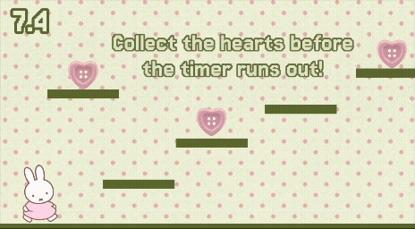

# MadMiffy
## A Miffy-themed WarioWare-style game that requires you to play minigames to win!

## Quick Start
Want to play? Play [MadMiffy on itch.io](https://ohkay404.itch.io/madmiffy "MadMiffy") now!

## Features
- 2D Platformer Minigame: Collect all the hearts to pass.
- Clicker Minigame: Click all hearts using the cursor to pass.
- Miffy's Bakery Minigame: Correctly select Miffy's bakery orders to pass.
- Whack-A-Miffy Minigame: Whack all the Miffies to pass.
- Settings Screen: Choose keyboard settings, toggle music, and adjust volume.
- Timer Screen: Tracks the number of lives remaining and indicates the player's current level.
- Winner Screen: Miffy floats away when the player wins.
- Death Screen: Miffy descends when the player loses.

## How to Run MadMiffy Locally
1. Clone this repository.
2. Import the project into Godot ver. 4.4.1.
3. Click run project to start the game.

## How it Works
MadMiffy is a collection of minigames consisting of different mechanics depending on the minigame. To move the `Sprite2D` in minigame 1, the player relies on either the left/right arrow keys or A/D keys to move, and the spacebar, up arrow, or W key to jump. In minigames 2, 3, and 4, the player clicks on targeted components using the cursor.

The game uses global variables `minigames_done` and `lives` to track the player's progress, and a `ThemedTimer` to track the time remaining in each minigame. The player starts with 5 lives in the form of hearts, and loses a life each time the player runs out of time before completing a minigame. If the player fails a minigame, the minigame repeats until the player passes or runs out of lives.

## Credits
- Changing sprite direction: [Mostly Mad Productions on Youtube](https://www.youtube.com/watch?v=xSs1Qx70Uck&t=10s "Mostly Mad Productions")
- Walking & idle animations and animation code in minigame 1: [DevWorm on Youtube](https://www.youtube.com/watch?v=GMyw3eHDw7s&t=2s "DevWorm")
- Background: [ninazaiid on Pinterest](https://www.pinterest.com/pin/666814288625883481/)
- Minigame 1 Sprite: [Pinterest](https://www.pinterest.com/pin/666814288625883495/), unknown creator
- Heart: [riri2090 on Pinterest](https://www.pinterest.com/pin/666814288625883505/)
- Miffy Holding Teddy Bear: [CreatiefSimpel on Pinterest](https://www.pinterest.com/pin/666814288625883497/)
- Miffy Holding Balloons: [carlawolff1982 on Pinterest](https://www.pinterest.com/pin/666814288625883500/)
- Crying Miffy Face: [Pinterest](https://www.pinterest.com/pin/666814288625883499/), unknown creator
- Bread: [doungruthaic58 on Pinterest](https://www.pinterest.com/pin/666814288626299157/)
- Strawberry Cake: [cocoonpoppy on Pinterest](https://www.pinterest.com/pin/666814288626299123/)
- Melon Bread: [yuyuzclub on Pinterest](https://www.pinterest.com/pin/666814288626314322/)
- Pancake Stack: [onwaillust on Pinterest](https://www.pinterest.com/pin/666814288626299121/)
- Minigame 3 Table: [Phsyki3 on Pinterest](https://www.pinterest.com/pin/666814288626314436/)
- Minigame 4 Miffy: [oneriotofemotion on Pinterest](https://www.pinterest.com/pin/666814288626703818/)
- Minigame 4 Grass Overlay: [ibrahimbarch2027 on Pinterest](https://www.pinterest.com/pin/666814288626753742/)
- Settings Screen Miffy: [kate22567 on Pinterest](https://www.pinterest.com/pin/666814288626703831/)

## AI Usage
I used ChatGPT and Gemini to debug. When I did not understand what certain errors meant in my code, or when I needed to know certain syntax (e.g. parsing an integer as a string), I used AI to understand why the error occurred, how to approach the error, and how syntax was used. All code was implemented by me.
